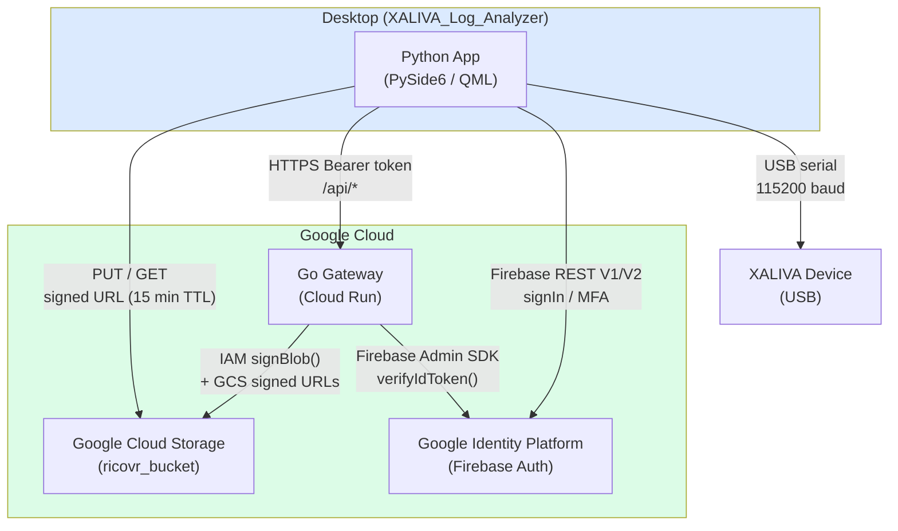
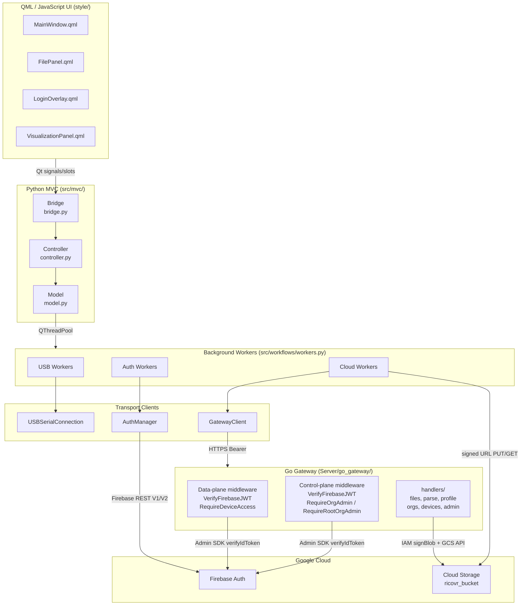
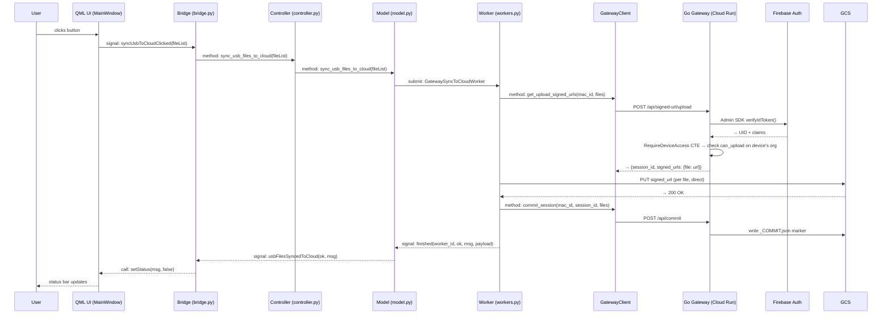
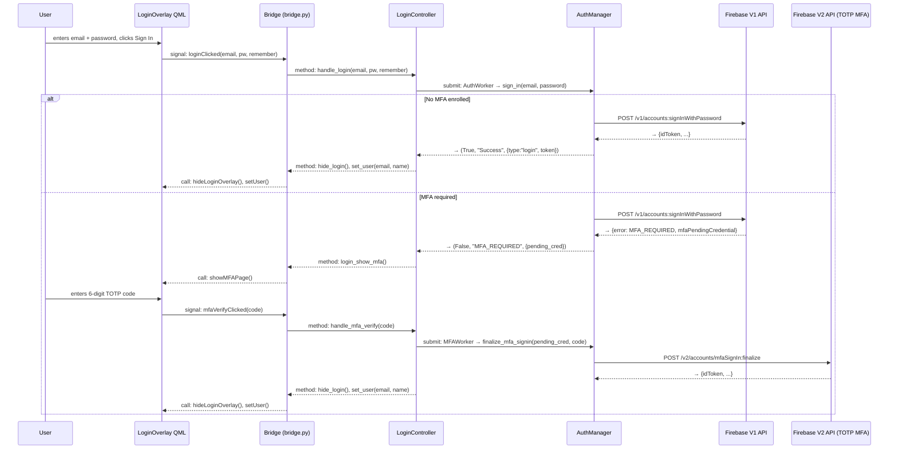
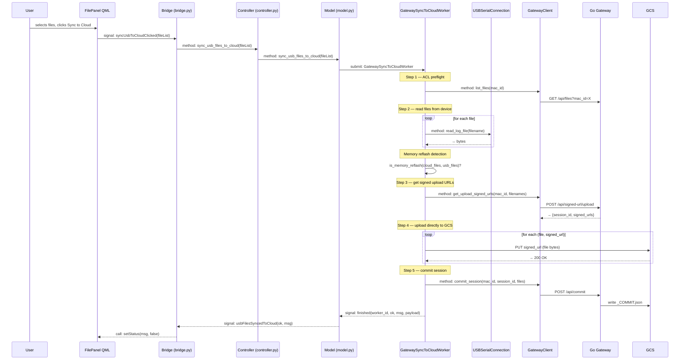
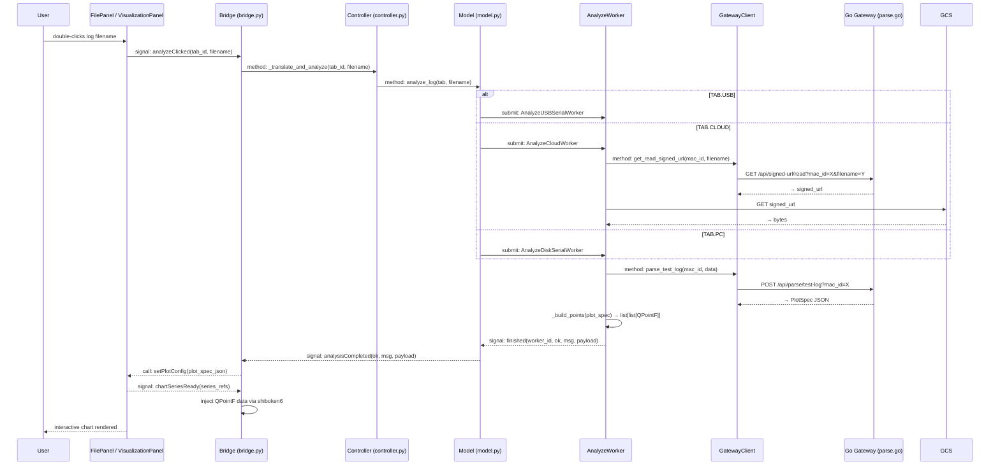
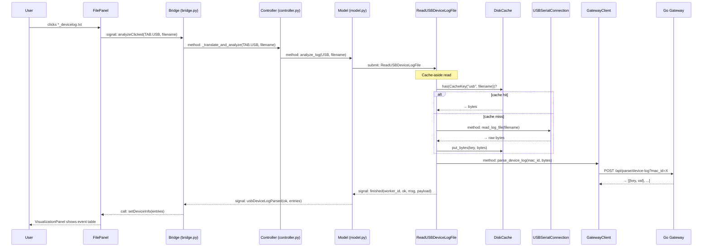
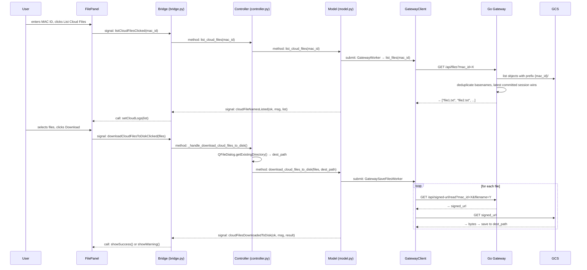

# XALIVA Log Analyzer


A desktop tool that reads logs from XALIVA devices over USB, securely uploads them to Google Cloud Storage through an authenticated Go API gateway, and visualises the data as interactive charts.

*[Insert UI screenshot here]*

---

## Monorepo Layout

```
XALIVA_Log_Analyzer/        ← repo root (this file lives here)
├── run.py                  Python client entry point
├── src/                    Python client source code
├── style/                  client-side QML / JavaScript UI
├── tests/                  pytest test suite for client code
├── environment.yml         Conda environment spec for client application
├── requirements.txt        Pip dependency lock for client application
├── log_analyzer.spec       PyInstaller bundle config for client application
├── admin_gui/              React Admin GUI (Control Plane web app)
└── Server/
    └── go_gateway/         Go 1.22 API gateway (Gin, Cloud Run, PostgreSQL)
```

---

## Table of Contents

1. [Getting Started](#getting-started)
2. [Directory Structure](#5-directory-structure)
3. [High-Level Design](#6-high-level-design)
   - [System Context](#6a-system-context-diagram)
   - [Layered Architecture](#6b-layered-architecture-diagram)
   - [User Interaction Sequence](#6c-generic-user-interaction-sequence)
   - [Authentication Flow](#6d-authentication-flow)
   - [USB → Cloud Sync Flow](#6e-usb--cloud-sync-flow)
   - [Log Analysis Flow](#6f-log-analysis-flow)
   - [Device Log Flow](#6g-device-log-event-log-flow)
   - [Cloud List + Download Flow](#6h-cloud-list--download-flow)
   - [CSV Export and Screenshot](#6i-csv-export-and-screenshot-flow)
4. [Go Gateway HTTP API Reference](#7-go-gateway-http-api-reference)
   - [Data Plane Routes](#7a-data-plane-routes-data_plane--unified)
   - [Control Plane Routes](#7b-control-plane-routes-control_plane--unified)
   - [Environment Variables](#7c-gateway-environment-variables)
5. [Directory-Level READMEs](#8-directory-level-readmes)

---

## Getting Started

For running the stack locally during development — conda environment, Python client, Go gateway with Docker Compose, Admin GUI, local PostgreSQL, and full stack orchestration — see [development.md](development.md).

For deploying to Google Cloud — Cloud Storage bucket, Cloud SQL, Secret Manager, IAM, Cloud Run, Firebase Hosting, Firebase Authentication, and desktop client distribution — see [cloud_deployment.md](cloud_deployment.md).

---

## 5. Directory Structure

```
XALIVA_Log_Analyzer/
├── README.md                              This file
├── run.py                                 Entry point
├── requirements.txt                       Pip dependency lock (87 packages)
├── environment.yml                        Conda environment spec (Python 3.12.11)
├── log_analyzer.spec                      PyInstaller bundle config
├── .env                                   Local env vars (not committed)
│
├── src/                                   Python application source
│   ├── main.py                            Qt bootstrap + logging setup
│   ├── constants.py                       Enums (ACTION, TAB), MSG strings, DEVICE_LOG_CODE_MAP
│   ├── dataclasses.py                     Parameter dataclasses for workers
│   ├── utils.py                           Pure helper functions
│   ├── mvc/
│   │   ├── model.py                       Data layer + worker orchestration
│   │   ├── bridge.py                      QML ↔ Python signal bridge (single QObject)
│   │   └── controller.py                  Signal wiring + OS dialog adapters
│   ├── login/
│   │   ├── auth_manager.py                Firebase REST API client (V1 + V2)
│   │   └── login_controller.py            Auth state machine
│   ├── usb_conn/
│   │   └── usbserialconnection.py         Serial protocol
│   ├── cloud_conn/
│   │   └── gateway_client.py              All gateway endpoint calls
│   ├── workflows/
│   │   └── workers.py                     17 worker classes (USB, Cloud, Auth)
│   └── disk_cache/
│       └── disk_cache.py                  Read-through disk cache
│
├── style/                                 QML / JavaScript UI
│   ├── MainWindow.qml                     Root ApplicationWindow; all runtime state
│   ├── Sidebar.qml / FilePanel.qml / LoginOverlay.qml / VisualizationPanel.qml
│   ├── Theme.qml                          Design-token singleton
│   ├── Strings.qml                        UI string constants (camelCase)
│   ├── components/                        Reusable QML primitives (XButton, XInput, FileList, …)
│   ├── logic/                             JavaScript behaviour objects
│   └── SIGNALS_REFERENCE.md              Complete signal wiring table
│
├── tests/                                 pytest test suite
│   ├── conftest.py
│   ├── test_controller.py
│   ├── test_gateway_client.py
│   ├── test_gateway_sync_worker.py
│   ├── test_login_form_clear.py
│   ├── test_auth_manager.py
│   ├── test_mfa_routing.py
│   └── integration/                       Live round-trip tests (require network)
│
├── logo/                                  SVG + ICO app assets
│
├── admin_gui/                             React Admin GUI (Control Plane web app)
│   ├── src/
│   │   ├── views/                         Page-level components (LoginView, OrgsView, UsersView, DevicesView, MfaSetupView)
│   │   ├── components/                    Shared UI primitives (AuthGuard, Sidebar, TableStates, …)
│   │   ├── contexts/AuthContext.tsx        Firebase auth state + MFA enrollment status
│   │   ├── hooks/                         useToast, useOrgSelector
│   │   ├── lib/                           Firebase client, API client, constants (MSG)
│   │   └── __tests__/                     Vitest + React Testing Library test suite
│   ├── Dockerfile                         Two-stage Node → nginx image
│   ├── docker-compose.yml                 Local dev orchestration
│   └── vite.config.ts
│
└── Server/
    └── go_gateway/                        Go API gateway
        ├── main.go                        Entry point; mode switch; CORS; Firebase + GCS + DB init
        ├── go.mod                         Go 1.22 module (gin, firebase-go/v4, cloud.google.com/go/storage)
        ├── api.yaml                       OpenAPI spec
        ├── Dockerfile                     Two-stage Alpine build → static binary
        ├── docker-compose.yml             Local dev orchestration (mounts SA key)
        ├── internal/
        │   ├── config/config.go           Typed env-var config (SERVER_MODE, DATABASE_URL, CORS_ORIGINS, …)
        │   └── db/db.go                   DB connection pool (DB_MAX_OPEN_CONNS, DB_MAX_IDLE_CONNS)
        ├── handlers/                      HTTP handler functions
        │   ├── admin.go                   CheckAdminAccess (GET /api/me/access)
        │   ├── devices.go                 ListOrgDevices, AddDevice, RemoveDevice
        │   ├── orgs.go                    Org CRUD handlers (CreateOrg, DeleteOrg, ListOrgs, UpsertOrgUser, …)
        │   ├── oob.go                     OOBSender interface + FirebaseOOBSender (invite emails on new-user creation)
        │   └── files.go / parse.go / profile.go / health.go / files_test.go
        └── middleware/                    Auth + device-access + org-admin + rate-limit
            ├── auth.go                    VerifyFirebaseJWT — Firebase JWT + TOTP MFA enforcement
            ├── device_access.go           RequireDeviceAccess — Postgres CTE ACL (read / upload)
            ├── org_admin.go               RequireOrgAdmin / IsOrgAdmin — recursive ancestor check on :org_id
            ├── super_admin.go             RequireRootOrgAdmin — root-org gate for user-deletion routes
            └── rate_limit.go              Token-bucket rate limiter
```

---

## 6. High-Level Design

### 6a. System Context Diagram



---

### 6b. Layered Architecture Diagram



---

### 6c. Generic User Interaction Sequence

> **Bearer token** — After login, Firebase issues a signed JSON Web Token (JWT). The Python client attaches it to every gateway request as `Authorization: Bearer <token>`. The Go Gateway verifies the signature using the Firebase Admin SDK — no network round-trip to Firebase per request. Tokens expire after 1 hour; the client re-authenticates to get a fresh one.



---

### 6d. Authentication Flow



**Firebase V1 vs V2 endpoint reference:**

| Operation | API | Endpoint |
|-----------|-----|----------|
| Sign in (no MFA) | V1 | `POST /v1/accounts:signInWithPassword` |
| Sign up | V1 | `POST /v1/accounts:signUp` |
| MFA sign-in finalize | V2 | `POST /v2/accounts/mfaSignIn:finalize` |
| MFA enroll start | V2 | `POST /v2/accounts/mfaEnrollment:start` |
| MFA enroll finalize | V2 | `POST /v2/accounts/mfaEnrollment:finalize` |
| Send password reset | V1 | `POST /v1/accounts:sendOobCode` |

**Forgot password:** `forgotPasswordClicked` → `showForgotPasswordForm()` (QML only) → user enters email → `forgotPasswordSubmitClicked(email)` → `ForgotPasswordWorker` → `auth_manager.send_password_reset(email)` → `showForgotPasswordSuccess(email)`.

**Gateway 401 handling:** Gateway returns 401 → `_auth_required_emitted` dedup flag in Model → `authRequired` signal → `bridge.show_login_expired()` → login overlay reappears.

---

### 6e. USB → Cloud Sync Flow



**GCS object layout:**

```
{mac_id}/{filename}                         ← legacy flat path (backward compat)
{mac_id}/{session_id}/{filename}            ← session-scoped path
{mac_id}/{session_id}/_COMMIT.json          ← commit marker; written by /api/commit
```

`ListFiles` returns only filenames from committed sessions — uncommitted uploads are invisible to readers.

---

### 6f. Log Analysis Flow



**PlotSpec JSON shape** (from `Server/go_gateway/handlers/parse.go`):

```json
{
  "success": true,
  "title": "Test Log — <filename>",
  "legend": {"visible": true, "position": "bottom"},
  "x_axis": {"label": "Time", "unit": "s"},
  "y_axes": [{"label": "Voltage", "unit": "V", "min": 0, "max": 5}],
  "series": [
    {"label": "Vbatt", "data": [...], "color": "#...", "y_axis": 0,
     "line_style": "solid", "line_width": 1.5, "marker_style": "none"}
  ],
  "x_values": [0.0, 0.01, 0.02, ...],
  "frequency": 100.0
}
```

---

### 6g. Device Log (Event Log) Flow



**Device log opcodes decoded by the gateway:**

| Opcode | Event |
|--------|-------|
| `0x01` | Bootup — `decodeStatusWord()` + `decodePostfailByte()` |
| `0x02` | Splash screen shown |
| `0x03` | Memory check |
| `0x04` | Run test started |
| `0x05` | Settings loaded |
| `0x06` | File vault entry |
| `0x07` | Battery status — `decodeBatteryByte()` → percentage |
| `0x08` | Test result |
| `0x09` | Config applied |
| `0x0F` | Shutdown |

---

### 6h. Cloud List + Download Flow



**`resolveObjectName` file resolution order:**
1. Probe legacy flat path `{mac_id}/{filename}` — if exists, return it.
2. List all objects matching `{mac_id}/*/{filename}`.
3. Keep only those whose session has a `_COMMIT.json` marker.
4. Return object from the lexicographically latest `session_id`.

---

### 6i. CSV Export and Screenshot Flow

```
User clicks Export CSV
  → bridge.exportCsvClicked → Controller._handle_export_csv()
  → QFileDialog.getSaveFileName() → path.csv
  → reconstruct rows from bridge._last_plot_spec → write CSV
  → bridge.show_success(MSG.Export.EXPORTED.format(path))

User clicks Screenshot
  → bridge.screenshotClicked → Controller._handle_screenshot_clicked()
  → QFileDialog.getSaveFileName() → path.png
  → grab VisualizationPanel chart → QImage → save PNG
  → bridge.show_success(MSG.Export.SCREENSHOT_SAVED.format(path))
```

---

## 7. Go Gateway HTTP API Reference

The gateway runs in one of three modes (`SERVER_MODE`): `DATA_PLANE`, `CONTROL_PLANE`, or `UNIFIED`. Routes are mounted per mode.

### 7a. Data Plane Routes (`DATA_PLANE` / `UNIFIED`)

| Method | Path | Auth | ACL gate | Handler | Description |
|--------|------|------|----------|---------|-------------|
| `GET` | `/health` | None | None | `Health()` | Liveness probe — `{"status":"ok"}` |
| `GET` | `/api/profile` | Bearer | — | `Profile()` | Returns uid and email from the `users` table |
| `GET` | `/api/files` | Bearer | RequireRead | `ListFiles()` | List committed filenames for `?mac_id=X` |
| `GET` | `/api/signed-url/read` | Bearer | RequireRead | `SignedReadURL()` | 15-min GCS GET signed URL for one file |
| `POST` | `/api/signed-url/upload` | Bearer | RequireWrite | `SignedUploadURL()` | Generate session + PUT signed URLs for file list |
| `POST` | `/api/commit` | Bearer | RequireWrite | `CommitSession()` | Write `_COMMIT.json` to atomically publish a session |
| `POST` | `/api/parse/device-log` | Bearer | RequireRead | `ParseDeviceLog()` | Decode binary event log → `[{key,val}]` |
| `POST` | `/api/parse/test-log` | Bearer | RequireRead | `ParseTestLog()` | Decode binary test log → `PlotSpec` JSON |

Middleware stack on device-scoped data-plane routes (applied in order):
1. `middleware.VerifyFirebaseJWT(authClient)` — Firebase ID token validation + TOTP MFA enforcement; 401 on invalid token, 403 with `{"code":"mfa_required"}` if TOTP second factor is absent
2. `middleware.RequireDeviceAccess(db, action)` — Postgres-backed device ACL. Admins (`role='admin'`): recursive org-tree walk, access granted if the role appears anywhere in the ancestor chain. Regular users: checked against the device's direct org only (`can_read` or `can_upload` flag required on that exact org). 403 if the check fails.

### 7b. Control Plane Routes (`CONTROL_PLANE` / `UNIFIED`)

All routes require a valid Bearer token (same JWT middleware as data plane, TOTP MFA enforced).

| Method | Path | Auth gate | Description |
|--------|------|-----------|-------------|
| `GET` | `/api/me/access` | Bearer | Returns 200 if caller has any admin role; 403 otherwise |
| `POST` | `/api/orgs` | Bearer + org admin of parent | Create a new org under `parent_org_id` |
| `GET` | `/api/orgs` | Bearer | List all orgs the caller can administer |
| `DELETE` | `/api/orgs/:org_id` | Bearer + org admin | Soft-delete an org |
| `GET` | `/api/orgs/:org_id/users` | Bearer + org admin | List active members of an org |
| `POST` | `/api/orgs/:org_id/users` | Bearer + org admin | Grant/update user permissions; creates Firebase account + sends invite email if user is new. Rate-limited: 10 req/min per IP |
| `DELETE` | `/api/orgs/:org_id/users/:user_id` | Bearer + org admin | Revoke org membership |
| `GET` | `/api/orgs/:org_id/devices` | Bearer + org admin | List active devices in an org |
| `POST` | `/api/orgs/:org_id/devices` | Bearer + org admin | Register a device to an org |
| `DELETE` | `/api/orgs/:org_id/devices/:mac_id` | Bearer + org admin | Soft-delete a device from an org |
| `DELETE` | `/api/users/:user_id` | Bearer + root-org admin | Permanently soft-delete a user account |

**Invite email flow:** When `POST /api/orgs/:org_id/users` is called for an email address that has no existing Firebase account, `UpsertOrgUser` creates the account via the Firebase Admin SDK and then calls `FirebaseOOBSender.SendPasswordResetEmail()` to deliver a set-password invite link. Existing users receive only the permission update; no email is sent.

---

### 7c. Gateway Environment Variables

| Variable | Required | Default | Description |
|---|---|---|---|
| `SERVER_MODE` | Yes | — | `DATA_PLANE`, `CONTROL_PLANE`, or `UNIFIED` |
| `FIREBASE_PROJECT_ID` | Yes | — | Firebase / GCP project ID |
| `SERVICE_ACCOUNT_EMAIL` | Yes | — | SA email used for IAM `signBlob()` to generate GCS signed URLs |
| `GCS_BUCKET` | Yes | — | GCS bucket name |
| `DATABASE_URL` | Yes (CONTROL_PLANE / UNIFIED) | — | Postgres connection string |
| `PORT` | No | `8080` | Port the HTTP server listens on |
| `CORS_ORIGINS` | No | `http://localhost:5173` | Comma-separated list of allowed CORS origins |
| `DB_MAX_OPEN_CONNS` | No | `5` | Max open DB connections in the pool |
| `DB_MAX_IDLE_CONNS` | No | `2` | Max idle DB connections in the pool |

---

## 8. Directory-Level READMEs

| Path | What it covers |
|------|---------------|
| [`Server/go_gateway/README.md`](Server/go_gateway/README.md) | Gateway full setup, startup sequence, GCS object layout, session lifecycle |
| [`Server/go_gateway/handlers/README.md`](Server/go_gateway/handlers/README.md) | Every handler function, binary protocol docs, test catalogue |
| [`Server/go_gateway/middleware/README.md`](Server/go_gateway/middleware/README.md) | Auth, device-access, org-admin, root-org-admin, and rate-limit middleware |
| [`admin_gui/src/README.md`](admin_gui/src/README.md) | React Admin GUI — views, auth context, MFA setup, testing |
| [`src/README.md`](src/README.md) | Startup sequence, full constants reference, utils, logging |
| [`src/mvc/README.md`](src/mvc/README.md) | Bridge, Model, Controller — complete signal/slot/method tables |
| [`src/login/README.md`](src/login/README.md) | Auth state machine, Firebase endpoints, MFA enrollment vs signin |
| [`src/workflows/README.md`](src/workflows/README.md) | All 17 worker classes — inputs, outputs, failure modes |
| [`src/cloud_conn/README.md`](src/cloud_conn/README.md) | `GatewayClient` method reference, error handling, upload flow |
| [`src/usb_conn/README.md`](src/usb_conn/README.md) | Serial protocol commands, `USBSerialConnection` API, cancel pattern |
| [`src/disk_cache/README.md`](src/disk_cache/README.md) | Cache design, `CacheKey`, `read_log_using_cache`, eviction |
| [`style/README.md`](style/README.md) | QML architecture, panel/logic split, Theme, Strings, signal wiring |
| [`style/components/README.md`](style/components/README.md) | Every component's property API, signals, usage snippets |
| [`style/logic/README.md`](style/logic/README.md) | Every `*Logic.qml` object's functions, property dependencies, bridge calls |
| [`tests/README.md`](tests/README.md) | Test strategy, fixtures, per-file catalogue with mocking strategy |
