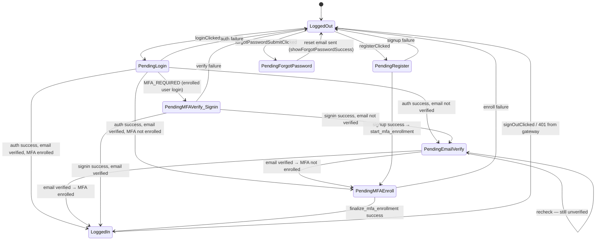

# login — Firebase Authentication

## Overview

Two classes handle authentication:

- **`AuthManager`** (`auth_manager.py`) — thin REST client for the Google Identity Platform REST API. Stateless except for the in-memory `id_token`.
- **`LoginController`** (`login_controller.py`) — auth state machine. Receives bridge signals, validates form input, calls Model slots, and drives the QML login overlay.

All `AuthManager` methods return `(success: bool, message: str, payload: dict)`.

---

## Auth State Machine



---

## Firebase Endpoint Reference

Base URLs:
- **V1:** `https://identitytoolkit.googleapis.com/v1/accounts`
- **V2:** `https://identitytoolkit.googleapis.com/v2/accounts`

All requests append `?key=<FIREBASE_API_KEY>` (from `constants.FIREBASE_API_KEY`).

---

### Sign In — `sign_in(email, password)`

**Endpoint:** `POST /v1/accounts:signInWithPassword`

**Request body:**
```json
{"email": "<email>", "password": "<password>", "returnSecureToken": true}
```

| Response | Condition | Action |
|----------|-----------|--------|
| **200** — no MFA | `idToken` present, no `mfaPendingCredential` | Store `id_token`, return `(True, MSG.Auth.SUCCESS, {"type": "login"})` |
| **200** — MFA required | `mfaPendingCredential` in body | Return `(False, MSG.Auth.MFA_REQUIRED, {"mfa_pending_cred": ..., "mfa_enrollment_id": ...})` |
| **400** `EMAIL_NOT_FOUND` / `INVALID_LOGIN_CREDENTIALS` | Bad credentials | Return `(False, error_message, {})` |
| **400** `TOO_MANY_ATTEMPTS_TRY_LATER` | Rate limited | Return `(False, error_message, {})` |
| **400** `USER_DISABLED` | Account disabled | Return `(False, error_message, {})` |
| Exception | Network/timeout | Return `(False, MSG.Auth.INTERNAL_ERROR, {})` |

---

### MFA Sign-In Verify — `verify_mfa_challenge(mfa_pending_credential, code, mfa_enrollment_id)`

**Endpoint:** `POST /v2/accounts/mfaSignIn:finalize`

**Request body:**
```json
{
  "mfaPendingCredential": "<credential from sign_in>",
  "totpVerificationInfo": {"verificationCode": "<6-digit code>"},
  "mfaEnrollmentId": "<id from mfaInfo[0]>"
}
```

| Response | Condition | Action |
|----------|-----------|--------|
| **200** | TOTP code valid | Store `id_token` + `refresh_token`, store email (fallback to saved), return `data` dict |
| **non-200** | Wrong code / expired credential | Raise `Exception("MFA Login Error: <Firebase message>")` |
| Exception | Network/timeout | Raise `Exception` |

---

### MFA Enroll Start — `start_mfa_enrollment()`

**Endpoint:** `POST /v2/accounts/mfaEnrollment:start`

**Request body:**
```json
{"idToken": "<current id_token>", "totpEnrollmentInfo": {}}
```

| Response | Condition | Action |
|----------|-----------|--------|
| **200** | Enrollment started | Return `(True, MSG.Auth.MFA_READY, {"secret": "<sharedSecretKey>", "session": "<sessionInfo>"})` |
| **non-200** | Token invalid or quota exceeded | Return `(False, error_message, {})` |
| Exception | Network/timeout | Return `(False, str(e), {})` |

---

### MFA Enroll Finalize — `finalize_mfa_enrollment(session_info, user_code)`

**Endpoint:** `POST /v2/accounts/mfaEnrollment:finalize`

**Request body:**
```json
{
  "idToken": "<current id_token>",
  "displayName": "XALIVA TOTP",
  "totpVerificationInfo": {"sessionInfo": "<session>", "verificationCode": "<code>"}
}
```

| Response | Condition | Action |
|----------|-----------|--------|
| **200** | Code valid | Store new `id_token`, return `(True, MSG.Auth.MFA_ENROLLED, {"type": "mfa_finalize"})` |
| **non-200** | Wrong code | Return `(False, MSG.Auth.MFA_ENROLL_FAILED, {})` |
| Exception | Network/timeout | Return `(False, MSG.Auth.INTERNAL_ERROR, {})` |

---

### Send Password Reset — `send_password_reset(email)`

**Endpoint:** `POST /v1/accounts:sendOobCode`

**Request body:**
```json
{"requestType": "PASSWORD_RESET", "email": "<email>"}
```

| Response | Condition | Action |
|----------|-----------|--------|
| **200** | Email sent | Return `(True, MSG.Auth.RESET_EMAIL_SENT, {"email": "<email>"})` |
| **400** `EMAIL_NOT_FOUND` | No account | Return `(False, error_message, {})` |
| Exception | Network/timeout | Return `(False, MSG.Auth.INTERNAL_ERROR, {})` |

---

### Send Email Verification — `send_verification_email()`

**Endpoint:** `POST /v1/accounts:sendOobCode`

**Request body:**
```json
{"requestType": "VERIFY_EMAIL", "idToken": "<current id_token>"}
```

| Response | Condition | Action |
|----------|-----------|--------|
| **200** | Sent | Return `(True, MSG.Auth.EMAIL_SENT, {})` |
| **non-200** | Token invalid / rate limited | Return `(False, MSG.Auth.EMAIL_FAILED, {})` |
| Exception | Network/timeout | Return `(False, MSG.Auth.EMAIL_CONN_ERROR, {})` |

---

### Get Account Info — `get_account_info()`

**Endpoint:** `POST /v1/accounts:lookup`

**Request body:**
```json
{"idToken": "<current id_token>"}
```

Used to check MFA enrollment status before deciding whether to show the enrollment flow.

| Response | Condition | Action |
|----------|-----------|--------|
| **200** | Token valid | Return `(True, "Info fetched", {"enrolled": bool, "details": [mfaInfo]})` |
| **non-200** | Token invalid | Return `(False, error_message, {"enrolled": False})` |
| Exception | Network/timeout | Return `(False, str(e), {"enrolled": False})` |

---

### Is Email Verified — `is_email_verified()`

**Endpoint:** `POST /v1/accounts:lookup`

Same endpoint as `get_account_info`. Checks `users[0].emailVerified`.

| Response | Condition | Action |
|----------|-----------|--------|
| **200** | Token valid | Return `(True, "Status fetched", {"verified": bool})` |
| Exception | Network/timeout | Return `(False, str(e), {"verified": False})` |

---

## Firebase Error Code → `MSG.Auth.*` Mapping

| Firebase error code | `MSG.Auth.*` constant | Shown to user |
|---------------------|-----------------------|---------------|
| `EMAIL_EXISTS` | `MSG.Auth.EMAIL_EXISTS` | "An account with this email already exists." |
| `INVALID_LOGIN_CREDENTIALS` | `MSG.Auth.INVALID_CREDENTIALS` | "Invalid email or password." |
| `TOO_MANY_ATTEMPTS_TRY_LATER` | `MSG.Auth.TOO_MANY_ATTEMPTS` | "Too many failed attempts. Try again later." |
| `MFA_REQUIRED` | (internal routing only) | Triggers MFA page, not surfaced directly |
| `INVALID_VERIFICATION_CODE` | `MSG.Auth.INVALID_MFA_CODE` | "Invalid verification code." |
| `USER_NOT_FOUND` | `MSG.Auth.USER_NOT_FOUND` | "No account found with this email." |

Firebase error codes arrive in `data["error"]["message"]`. Unknown codes are passed through as-is.

---

## `LoginController` API

Receives bridge signals via `ApplicationController._wire_auth_signals()`.

### `@Slot` Handlers

| Handler | Triggering bridge signal | Validates | Calls |
|---------|--------------------------|-----------|-------|
| `handle_login(email, pw, remember)` | `loginClicked` | Non-empty fields | `model.sign_in_user(email, pw)` |
| `handle_register(email, pw, confirm)` | `registerClicked` | Non-empty, pw == confirm, pw strength | `model.sign_up_user(email, pw)` |
| `handle_mfa_verify(code)` | `mfaVerifyClicked` | 6-digit code | `model.verify_mfa_login(...)` or `model.finalize_mfa_enrollment(...)` |
| `handle_forgot_password_nav()` | `forgotPasswordClicked` | — | `bridge.show_forgot_password_form()` |
| `handle_forgot_password_submit(email)` | `forgotPasswordSubmitClicked` | Non-empty email | `model.send_password_reset(email)` |
| `handle_sign_out()` | `signOutClicked` | — | `model.sign_out()`, `bridge.hide_login(False)` |

### `on_auth_finished(success, msg, payload)` dispatcher

| `payload["type"]` | Action |
|-------------------|--------|
| `"login"` | Store token, `bridge.hide_login()`, `bridge.set_user(email, name)` |
| `"mfa"` | Set `_is_login_challenge = True`, call `on_mfa_qr_ready` or `login_show_mfa` |
| `"signup"` | Auto-start TOTP enrollment via `model.start_mfa_enrollment()` |
| `"enroll_start"` | Generate QR PNG, `bridge.login_show_mfa(qr_base64_uri)` |
| `"enroll_done"` | Send verification email, `bridge.hide_login()` |
| `"forgot_password"` | `bridge.show_forgot_password_success(email)` |

---

## MFA Enrollment vs MFA Signin — Side-by-Side

| | MFA Enrollment (after signup) | MFA Signin (returning user) |
|-|------------------------------|------------------------------|
| Trigger | `sign_up` success | `sign_in` returns `MFA_REQUIRED` |
| `_is_login_challenge` | `False` | `True` |
| Pending state | `sessionInfo` from `mfaEnrollment:start` | `mfaPendingCredential` from `signInWithPassword` |
| Finalize endpoint | `POST /v2/accounts/mfaEnrollment:finalize` | `POST /v2/accounts/mfaSignIn:finalize` |
| QR code shown | Yes — user must scan to set up authenticator | No — user already has authenticator |
| After success | Email verification sent, user logged in | User logged in |

---

## emailVerified gate — invite-only path

After a successful login (password or MFA), `_on_auth_done` in `Model` calls `get_account_info()` which returns both `email_verified` and `enrolled`. The gates run strictly in order — the email check blocks before the MFA enrollment check, which blocks before the gateway access check.

**Why the email gate is not expected to trigger under normal use:**

Users are added exclusively via the Go Gateway invite flow (`POST /api/orgs/:id/users`). The gateway creates the Firebase account via the Admin SDK (default `emailVerified = false`) and then sends a **password-reset OOB code**. When the invited user clicks that link and sets their password, Firebase sets `emailVerified = true` as a side effect — receiving and acting on the link proves ownership of the address.

Accounts created directly in the **Firebase console** receive no OOB email automatically. They arrive with `emailVerified = false` and are held at the `PendingEmailVerify` state until a verification link is clicked. This is only expected during manual testing or bootstrap.

---

## Gotchas

- **V2 endpoints require a live V1 token** — `mfaEnrollment:start` and `:finalize` need the `idToken` from the V1 sign-in or sign-up response. If the V1 call fails, the V2 call cannot proceed.
- **`mfaPendingCredential` is short-lived** — Firebase invalidates it after ~5 minutes. If the user takes too long to enter their TOTP code, the signin must be restarted from the beginning.
- **Token storage is RAM-only** — `AuthManager.id_token` is never written to disk. A crash or forced quit discards the token; the user must log in again on next launch.
- **`mfa_enrollment_id` is required for v2 MFA signin** — extracted from `mfaInfo[0].mfaEnrollmentId` in the `signInWithPassword` response. Without it, `mfaSignIn:finalize` may fail on accounts with multiple enrolled factors.

---

## Related Files

- [`src/mvc/README.md`](../mvc/README.md) — `Model` auth slots and `Bridge` auth signals
- [`src/workflows/README.md`](../workflows/README.md) — `AuthWorker`, `MFAWorker`, `ForgotPasswordWorker`
- [`src/cloud_conn/README.md`](../cloud_conn/README.md) — `GatewayClient` that consumes the token
- [`src/README.md`](../README.md) — startup sequence
