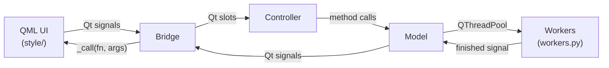

# mvc — Model-View-Controller Layer

## Overview

The MVC layer connects the QML UI to Python business logic using Qt signals/slots. Three classes form the layer:



---

## `bridge.py` — Bridge

Single `QObject` that is the **only** object exposed to QML. QML calls Python by emitting signals declared on the bridge; Python calls QML via `_call()`.

### QML → Python Signals

These signals are emitted by QML and received by `@Slot` handlers in `Controller` or `LoginController`.

| Signal | Args | Routed to |
|--------|------|-----------|
| `detectClicked` | — | `model.detect_ports()` |
| `connectClicked` | `port: str` | `model.connect_to_port(port)` |
| `disconnectClicked` | — | `model.disconnect_usb()` |
| `listUsbFilesClicked` | — | `model.list_usb_files()` |
| `analyzeClicked` | `tab: int, filename: str` | `controller._translate_and_analyze(tab, filename)` |
| `saveAllUsbFilesClicked` | — | `controller._handle_save_all_usb()` |
| `saveOneUsbFileClicked` | `filename: str` | `controller._handle_save_one_usb(filename)` |
| `syncUsbToCloudClicked` | `file_list: list` | `model.sync_usb_files_to_cloud(file_list)` |
| `listCloudFilesClicked` | `mac_id: str` | `model.list_cloud_files(mac_id)` |
| `downloadCloudFilesToDiskClicked` | `files: list` | `controller._handle_download_cloud_files_to_disk(files)` |
| `browsePcClicked` | — | `controller._handle_browse_pc()` |
| `exportCsvClicked` | — | `controller._handle_export_csv()` |
| `screenshotClicked` | — | `controller._handle_screenshot_clicked()` |
| `loginClicked` | `email, pw, remember` | `login_controller.handle_login(...)` |
| `registerClicked` | `email, pw, confirm` | `login_controller.handle_register(...)` |
| `mfaVerifyClicked` | `code: str` | `login_controller.handle_mfa_verify(code)` |
| `forgotPasswordClicked` | — | `login_controller.handle_forgot_password_nav()` |
| `forgotPasswordSubmitClicked` | `email: str` | `login_controller.handle_forgot_password_submit(email)` |
| `signOutClicked` | — | `login_controller.handle_sign_out()` |
| `chartSeriesReady` | `series_refs: list` | `bridge.on_chart_series_ready(series_refs)` |
| `closeRequested` | — | `bridge.on_close_requested()` |

### Python → QML Methods

`_call(fn_name, args)` calls `getattr(root, fn_name)(*args)` where `root` is the QML `ApplicationWindow` object set by `bridge.set_root(root)`.

| Python method | QML function called | Effect |
|---------------|---------------------|--------|
| `set_status(msg, is_error)` | `setStatus` | Updates status bar text and colour |
| `set_user(email, name)` | `setUser` | Populates sidebar user info |
| `set_usb_logs(files)` | `setUsbLogs` | Populates USB tab file list |
| `set_cloud_logs(files)` | `setCloudLogs` | Populates Cloud tab file list |
| `set_pc_files(files)` | `setPcFiles` | Populates PC tab file list |
| `set_usb_ports(ports)` | `setUsbPorts` | Populates port ComboBox |
| `set_usb_busy(active, msg)` | `setUsbBusy` | Shows/hides USB tab busy overlay |
| `set_cloud_busy(active, msg)` | `setCloudBusy` | Shows/hides Cloud tab busy overlay |
| `show_error(msg)` | `showError` | Shows error toast |
| `show_success(msg)` | `showSuccess` | Shows success toast |
| `show_warning(msg)` | `showWarning` | Shows warning toast |
| `hide_login(success)` | `hideLoginOverlay` | Closes login overlay after auth |
| `login_show_mfa(qr_uri)` | `showMFAPage` | Switches overlay to MFA page |
| `show_login_expired()` | `showLoginExpiredOverlay` | Re-shows login overlay on 401 |
| `show_forgot_password_form()` | `showForgotPasswordForm` | Switches overlay to forgot-pw page |
| `show_forgot_password_success(email)` | `showForgotPasswordSuccess` | Shows reset-sent confirmation |
| `set_device_info(entries)` | `setDeviceInfo` | Populates device log table |
| `set_plot_config(spec_json)` | `setPlotConfig` | Initialises chart with PlotSpec |

### `@Slot` Handlers (Model → Bridge)

These slots receive model signals and translate them into QML calls.

| Model signal | Bridge slot | QML update |
|---|---|---|
| `portsDetected(ports)` | `on_ports_detected` | `set_usb_ports(ports)` |
| `connectionStatusChanged(ok, msg)` | `on_connection_status` | `set_status`, `set_usb_busy(False)` |
| `usbFileNamesListed(ok, msg, files)` | `on_usb_files_listed` | `set_usb_logs(files)` |
| `analysisCompleted(ok, msg, payload)` | `on_analysis_completed` | Stash `_last_plot_spec`, `_pending_pts`; call `set_plot_config` |
| `usbFilesSyncedToCloud(ok, msg)` | `on_usb_files_synced` | `set_status`, `set_usb_busy(False)` |
| `cloudFileNamesListed(ok, msg, files)` | `on_cloud_files_listed` | `set_cloud_logs(files)` |
| `cloudFilesDownloadedToDisk(ok, msg, result)` | `on_cloud_files_downloaded` | `show_success` or `show_warning` |
| `usbFilesSavedToDisk(ok, msg)` | `on_usb_files_saved` | `set_status`, `set_usb_busy(False)` |
| `usbDeviceLogParsed(ok, entries)` | `on_usb_device_log_parsed` | `set_device_info(entries)` |
| `authFinished(ok, msg, payload)` | forwarded to `LoginController.on_auth_finished` | varies |
| `allWorkersDone()` | `on_all_workers_done` | Sets `_safe_to_close = True`, triggers Qt quit |

### Chart Injection — `_last_plot_spec` / `_pending_pts`

When `analysisCompleted` arrives, the bridge stashes `plot_spec` and `pts_per_series` locally. It then calls `set_plot_config(spec_json)` which tells QML to create chart series objects. QML emits `chartSeriesReady(series_refs)` back when the series are constructed. The bridge's `on_chart_series_ready` slot then injects `QPointF` data into the series via `shiboken6` direct object access — bypassing JSON serialisation for performance.

### `_safe_to_close` Gate

`closeRequested` triggers a graceful shutdown: Model cancels all workers, emits `allWorkersDone` when the last worker finishes, Bridge sets `_safe_to_close = True` and calls `QCoreApplication.quit()`. This prevents data corruption from killed workers.

---

## `model.py` — Model

Owns all stateful resources: USB connection, gateway client, disk cache, auth manager. Submits workers to `QThreadPool` and emits Qt signals when workers complete.

### Qt Signals

| Signal | Params | Emitted when |
|--------|--------|--------------|
| `portsDetected` | `list` | USB port scan complete |
| `connectionStatusChanged` | `bool, str` | Port connect/disconnect |
| `usbFileNamesListed` | `bool, str, list` | USB file list complete |
| `usbFilesSavedToDisk` | `bool, str` | USB save-to-disk complete |
| `usbFilesSyncedToCloud` | `bool, str` | Cloud sync complete |
| `cloudFileNamesListed` | `bool, str, list` | Cloud file list complete |
| `cloudFilesDownloadedToDisk` | `bool, str, dict` | Cloud download complete |
| `analysisCompleted` | `bool, str, object` | Log analysis complete |
| `usbDeviceLogParsed` | `bool, list` | Device log parse complete |
| `authFinished` | `bool, str, object` | Auth or MFA action complete |
| `mfaQrReady` | `str` | TOTP URI ready for QR generation |
| `authRequired` | — | Gateway returned 401 (deduped) |
| `allWorkersDone` | — | All active workers finished (shutdown) |
| `progressUpdated` | `str, int, str` | Worker emitted progress |

### Public `@Slot` Methods

| Method | Called by | Action |
|--------|-----------|--------|
| `detect_ports()` | Controller | Submit `DetectUSBSerialWorker` |
| `connect_to_port(port)` | Controller | Submit `ConnectUSBSerialWorker` |
| `disconnect_usb()` | Controller | Submit `DisconnectUSBSerialWorker` |
| `list_usb_files()` | Controller | Submit `ListUSBSerialWorker` |
| `analyze_log(tab, filename)` | Controller | Pick worker by `TAB` enum; submit |
| `save_all_usb_files_to_disk(files, dest)` | Controller | Submit `SaveAllUSBSerialWorker` |
| `save_one_usb_file_to_disk(filename, dest)` | Controller | Submit `SaveOneUSBFileWorker` |
| `sync_usb_files_to_cloud(file_list)` | Controller | Submit `GatewaySyncToCloudWorker` |
| `list_cloud_files(mac_id)` | Controller | Submit `GatewayWorker(LIST)` |
| `download_cloud_files_to_disk(files, dest)` | Controller | Submit `GatewaySaveFilesWorker` |
| `sign_in_user(email, pw)` | LoginController | Submit `AuthWorker(SIGNIN)` |
| `sign_up_user(email, pw)` | LoginController | Submit `AuthWorker(SIGNUP)` |
| `verify_mfa_login(pending_cred, code)` | LoginController | Submit `MFAWorker(FINALIZE_SIGNIN)` |
| `start_mfa_enrollment(id_token)` | LoginController | Submit `MFAWorker(ENROLL_START)` |
| `finalize_mfa_enrollment(id_token, session_info, code)` | LoginController | Submit `MFAWorker(ENROLL_FINALIZE)` |
| `send_password_reset(email)` | LoginController | Submit `ForgotPasswordWorker` |
| `sign_out()` | LoginController | Clear `auth_manager.id_token` |
| `set_mac_id(mac_id)` | Controller | Store current device MAC ID |
| `cleanup()` | Bridge (shutdown) | Cancel workers, clear cache, close USB |

### Worker Lifecycle

```python
_active_workers: dict[str, BaseThreadWorker]  # worker_id → worker
```

`_register_worker(worker)` adds to `_active_workers` and starts the worker. `_on_worker_finished(worker_id, ...)` removes from `_active_workers`; if empty during shutdown, emits `allWorkersDone`.

### `_handlers` Dispatch Table

`_on_worker_finished` routes successful payloads based on `worker.action`:

```python
_handlers: dict[ACTION, Callable[[dict], None]] = {
    ACTION.DETECT_USB_SERIAL_PORTS: self._handle_ports_detected,
    ACTION.CONNECT_USB_SERIAL_PORT: self._handle_connection_status,
    ACTION.LIST_USB_FILES: self._handle_usb_files_listed,
    ACTION.SAVE_ALL_USB_FILES_TO_DISK: self._handle_usb_files_saved,
    ACTION.UPLOAD_USB_FILES_TO_CLOUD: self._handle_usb_files_synced,
    ACTION.LIST_CLOUD_FILES: self._handle_cloud_files_listed,
    ACTION.DOWNLOAD_CLOUD_FILES_TO_DISK: self._handle_cloud_files_downloaded,
    ACTION.AUTHENTICATE: self._handle_auth_finished,
    ACTION.MFA_ACTION: self._handle_auth_finished,
    ...
}
```

### `_auth_required_emitted` 401 Dedup Flag

When a gateway call returns 401, the worker emits `finished(False, GATEWAY_STATUS.UNAUTHORIZED, {})`. `_on_worker_finished` checks `_auth_required_emitted`:
- If `False`: set to `True`, emit `authRequired` → Controller calls `bridge.show_login_expired()`.
- If `True`: ignore (prevents multiple login-expired overlays from concurrent workers).

Reset to `False` on successful login.

---

## `controller.py` — ApplicationController

Pure wiring class — no business logic. Constructed in `main.py` after all other objects exist.

### `_wire_qml_to_model()`

Connects bridge signals to model/controller methods:

| Bridge signal | Connected to |
|---------------|-------------|
| `detectClicked` | `model.detect_ports` |
| `connectClicked` | `model.connect_to_port` |
| `disconnectClicked` | `model.disconnect_usb` |
| `listUsbFilesClicked` | `model.list_usb_files` |
| `analyzeClicked` | `_translate_and_analyze` |
| `saveAllUsbFilesClicked` | `_handle_save_all_usb` |
| `saveOneUsbFileClicked` | `_handle_save_one_usb` |
| `syncUsbToCloudClicked` | `model.sync_usb_files_to_cloud` |
| `listCloudFilesClicked` | `model.list_cloud_files` |
| `downloadCloudFilesToDiskClicked` | `_handle_download_cloud_files_to_disk` |
| `browsePcClicked` | `_handle_browse_pc` |
| `exportCsvClicked` | `_handle_export_csv` |
| `screenshotClicked` | `_handle_screenshot_clicked` |

### `_wire_model_to_bridge()`

Connects model signals to bridge slots:

| Model signal | Bridge slot |
|---|---|
| `portsDetected` | `bridge.on_ports_detected` |
| `connectionStatusChanged` | `bridge.on_connection_status` |
| `usbFileNamesListed` | `bridge.on_usb_files_listed` |
| `usbFilesSavedToDisk` | `bridge.on_usb_files_saved` |
| `usbFilesSyncedToCloud` | `bridge.on_usb_files_synced` |
| `cloudFileNamesListed` | `bridge.on_cloud_files_listed` |
| `cloudFilesDownloadedToDisk` | `bridge.on_cloud_files_downloaded` |
| `analysisCompleted` | `bridge.on_analysis_completed` |
| `usbDeviceLogParsed` | `bridge.on_usb_device_log_parsed` |
| `authFinished` | `login_controller.on_auth_finished` |
| `mfaQrReady` | `login_controller.on_mfa_qr_ready` |
| `authRequired` | `bridge.show_login_expired` |
| `allWorkersDone` | `bridge.on_all_workers_done` |
| `progressUpdated` | `bridge.on_progress` |

### OS Dialog Adapters

QML cannot open native OS dialogs directly. Controller methods open them on the main thread:

| Method | Dialog | Calls after |
|--------|--------|-------------|
| `_handle_browse_pc()` | `QFileDialog.getExistingDirectory()` | `model.set_pc_path(path)` |
| `_handle_save_all_usb()` | `QFileDialog.getExistingDirectory()` | `model.save_all_usb_files_to_disk(files, dest)` |
| `_handle_save_one_usb(filename)` | `QFileDialog.getExistingDirectory()` | `model.save_one_usb_file_to_disk(filename, dest)` |
| `_handle_download_cloud_files_to_disk(files)` | `QFileDialog.getExistingDirectory()` | `model.download_cloud_files_to_disk(files, dest)` |
| `_handle_export_csv()` | `QFileDialog.getSaveFileName()` | Reconstruct rows from `bridge._last_plot_spec` → write CSV |
| `_handle_screenshot_clicked()` | `QFileDialog.getSaveFileName()` | Grab `VisualizationPanel` → `QImage` → save PNG |

### `_translate_and_analyze(tab, filename)`

For the PC tab (`TAB.PC`), QML passes only a basename. The controller resolves the full absolute path from the PC directory before calling `model.analyze_log(tab, full_path)`. USB and Cloud tabs pass filenames through unchanged.

---

## Related Files

- [`src/workflows/README.md`](../workflows/README.md) — worker classes submitted by Model
- [`src/login/README.md`](../login/README.md) — LoginController wired by `_wire_auth_signals`
- [`style/README.md`](../../style/README.md) — QML side of the bridge
- [`src/README.md`](../README.md) — startup sequence
