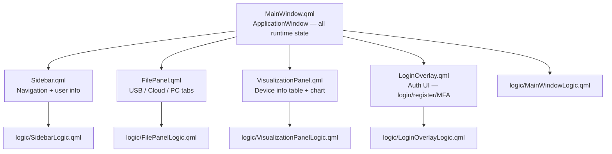

# style — QML / JavaScript UI

## Overview

The `style/` directory contains all QML and JavaScript for the desktop UI. It follows a strict panel/logic split: panels own declarative layout, logic objects own imperative behaviour. Full signal wiring table: [`SIGNALS_REFERENCE.md`](SIGNALS_REFERENCE.md).

---

## Component Tree



---

## Panel / Logic Split

Each panel has a paired `*Logic.qml` `QtObject`. The pattern:

1. The panel declares all UI elements with IDs and binds state properties from `window.*`.
2. It instantiates `*Logic.qml` and passes itself (and `window`) via property injection.
3. Signal handlers in the panel call logic functions: `onClicked: logic.handleFoo()`.
4. The logic object calls bridge signals via `callBridge(fn)`.
5. **Logic objects never reference element IDs from the parent panel.** They only use injected references.

```qml
// In FilePanel.qml
FilePanelLogic {
    id: logic
    panel: filePanelRoot   // inject self
    window: mainWindow     // inject root window
}

XButton {
    label: "List Files"
    onClicked: logic.handleListUsb()   // panel → logic → bridge
}
```

---

## State Ownership

**All runtime state lives in `MainWindow.qml`** as top-level properties:

```qml
ApplicationWindow {
    property int     activeTab: 0
    property bool    usbConnected: false
    property var     usbLogs: []
    property var     cloudLogs: []
    property var     pcFiles: []
    property var     usbPorts: []
    property string  userEmail: ""
    property string  userName: ""
    property var     deviceInfo: []
    property var     plotSpec: null
    property bool    plotVisible: false
    property bool    usbBusy: false
    property string  usbBusyMessage: ""
    property bool    cloudBusy: false
    property string  cloudBusyMessage: ""
    property string  toastMessage: ""
    property string  toastLevel: "info"
    property bool    loginVisible: true
    property int     loginMode: 0
}
```

Child panels bind to these properties directly. Python updates state by calling `bridge._call("setFoo", [value])`.

---

## Theme Singleton

`Theme.qml` provides design tokens. Import with:

```qml
import "." as App

Rectangle { color: App.Theme.surface }
Text { font.pixelSize: App.Theme.fontSizeSm; color: App.Theme.textPrimary }
```

Token categories:

| Category | Examples |
|----------|---------|
| Colors | `primary` (#4698CB), `accent`, `surface`, `background`, `border`, `textPrimary`, `textSecondary`, `error`, `success`, `warning` |
| Fonts | `fontSizeSm` (12 px), `fontSizeMd` (14 px), `fontSizeLg` (16 px) |
| Spacing | `spacingXs` (4), `spacingSm` (8), `spacingMd` (16), `spacingLg` (24) |
| Radii | `radiusSm` (4), `radiusMd` (6), `radiusLg` (12) |

---

## Strings Singleton

`Strings.qml` holds all user-facing string constants. Property names use **camelCase** — QML property binding requires lowercase initial letters. Never use `UPPER_SNAKE_CASE`.

```qml
import "." as App
Text { text: App.Strings.usbFetching }
```

---

## How Python Loads the UI

```python
# src/main.py (simplified)
bridge = Bridge()
engine = QQmlApplicationEngine()
engine.setInitialProperties({"bridge": bridge, "xaliva_logo": logo_uri})
engine.load("style/MainWindow.qml")
bridge.set_root(engine.rootObjects()[0])   # enables bridge._call() → QML JS
```

`ApplicationController` wires all Qt signals before the engine loads:
- `bridge` signals (QML → Python) → `model` slots
- `model` signals (Python → QML) → `bridge` `@Slot` handlers
- auth signals → `LoginController`

---

## QML ↔ Python Signal Wiring Summary

### QML → Python
```
User action → component signal → panel handler → logic.handleFoo()
  → callBridge(() => window.bridge.fooClicked()) → Controller slot
  → Model method → Worker submitted to QThreadPool
```

### Python → QML
```
Worker finished → Model signal → Bridge @Slot
  → bridge._call("setFoo", [val]) → getattr(root, "setFoo")(val)
  → MainWindowLogic JS function → window.* property updated
  → all bound QML elements re-render
```

Full table: [`SIGNALS_REFERENCE.md`](SIGNALS_REFERENCE.md)

---

## Qt 6 Gotchas

- **Explicit signal handler parameters** — never use implicit `mouse`, `wheel`, `drag` in handlers:
  ```qml
  // WRONG
  onClicked: { console.log(mouse.x) }
  // RIGHT
  onClicked: function(mouse) { console.log(mouse.x) }
  ```
- **`QT_QUICK_CONTROLS_STYLE = "Basic"`** — set before `QApplication` in `src/main.py`; missing it lets the native platform style override QML controls.
- **Bridge null guard** — `window.bridge` is `null` until `bridge.set_root()` completes. All logic objects guard via `callBridge(fn)`.
- **`BusyOverlay` in `StackLayout`** — wrap the tab's `ColumnLayout` and `BusyOverlay` in a plain `Item`; overlays need a sibling, not a child of the layout manager.

---

## Directory Structure

```
style/
├── MainWindow.qml             Root ApplicationWindow; all runtime state properties
├── Sidebar.qml                Navigation panel (recent files, user info, sign-out)
├── FilePanel.qml              USB / Cloud / PC file browser with tabs
├── VisualizationPanel.qml     Device info table, log text, interactive chart
├── LoginOverlay.qml           Auth UI (login / register / MFA / forgot-password)
├── Theme.qml                  Design-token singleton
├── Strings.qml                UI string constants (camelCase)
├── qmldir                     Registers Theme and Strings as QML singletons
├── SIGNALS_REFERENCE.md       Complete signal wiring table
├── components/                Reusable QML primitives
│   ├── XButton.qml
│   ├── XInput.qml
│   ├── XInputPassword.qml
│   ├── FileList.qml
│   ├── FileListLogic.qml
│   ├── BusyOverlay.qml
│   ├── NavItem.qml
│   └── SSOButton.qml
└── logic/                     JavaScript behaviour objects
    ├── MainWindowLogic.qml
    ├── FilePanelLogic.qml
    ├── LoginOverlayLogic.qml
    ├── SidebarLogic.qml
    └── VisualizationPanelLogic.qml
```

---

## Related Files

- [`style/components/README.md`](components/README.md)
- [`style/logic/README.md`](logic/README.md)
- [`style/SIGNALS_REFERENCE.md`](SIGNALS_REFERENCE.md)
- [`src/mvc/README.md`](../src/mvc/README.md) — Python bridge implementation
- [Root README](../README.md)
